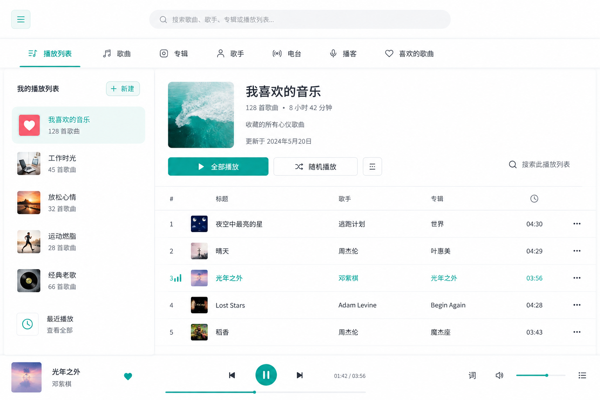
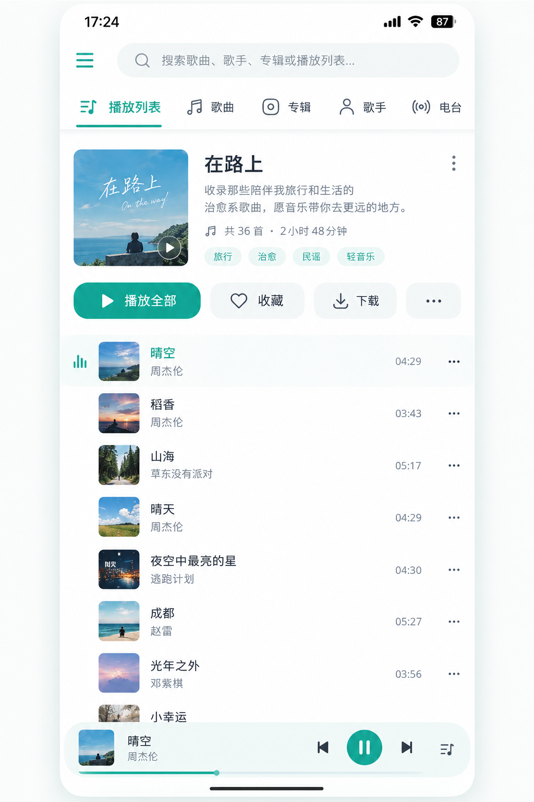

<p align="center">
  
</p>

<h1 align="center">SelfMusic</h1>

<p align="center">
  <strong>把音乐留在自己的磁盘里，把播放器握在自己手里。</strong><br>
  去中心化的个人音乐服务 · Flutter 四端客户端 + 可选的 Spring Boot 服务端
</p>

<p align="center">
  
  
  
  
  
</p>

> **许可提示**：本项目采用 PolyForm Noncommercial License 1.0.0，**禁止将本项目及其修改版、衍生作品用于付费产品或任何商业用途**。个人学习、研究、自用等非商业用途请遵守 [LICENSE](LICENSE)。

SelfMusic 是一个**自建自用的个人音乐服务**。它不接入任何音乐平台账号，也不要求你把音乐上传到第三方：你只需要告诉它音乐在哪里——本地文件夹、NAS 的 SMB 共享、WebDAV 网盘、SFTP 服务器——扫描、索引、播放、歌单、歌词和离线缓存都在客户端完成。

## 目录

- [项目介绍](#项目介绍)
- [界面](#界面)
- [亮点](#亮点)
- [功能一览](#功能一览)
- [架构](#架构)
- [部署](#部署)
- [开发](#开发)
- [文档](#文档)
- [许可](#许可)

## 项目介绍

SelfMusic 有两种使用方式：

- **直连模式（默认）**：不部署后端也能完整使用。客户端直接通过协议读取音乐源，单机与离线场景没有服务端依赖。
- **服务端模式（可选）**：部署一个单用户的 Spring Boot 服务，在多台设备之间同步权重、收藏、歌单、播放源和断点，并获得跨设备续播、按需转码、响度均衡与设备管理能力。

后端不保存歌曲、不建立曲库；音乐始终留在你自己的存储里。

> 适合：音乐收藏散落在 NAS / 网盘 / 本地硬盘，想要一个不依赖流媒体平台账号、可自托管、跨设备可用的播放器的人。

SelfMusic 围绕两个原则设计：

1. **客户端优先。** 曲库索引、歌单、权重、断点、缓存都在客户端本地，直连播放不依赖服务器在线；没有后端时，App 依然是一个完整的音乐播放器。
2. **服务端只做增强。** 后端负责设备配对、状态同步和无状态转码代理，不托管音乐、不保存曲库。你的音乐文件在哪里，就继续在哪里。

客户端使用同一套 Dart 业务代码运行在四个平台：

| 平台 | 定位 | 音频后端 |
|------|------|---------|
| Linux | 桌面开发与日常使用 | media_kit / libmpv（随包分发） |
| Windows | 桌面 | media_kit / libmpv（随包分发） |
| Android | 手机 / 平板 | just_audio / ExoPlayer，通知栏后台播放 |
| HarmonyOS NEXT | 手机 / 平板 | 系统 AVPlayer + AVSession 媒体卡 |

> 项目按个人使用需求持续迭代，四端同步推进；HarmonyOS NEXT 经三方 Flutter 分支适配，已在真机日常使用。

## 界面

<p align="center">
  
</p>
<p align="center"><sub>桌面端 · Linux / Windows</sub></p>

<p align="center">
  
</p>
<p align="center"><sub>移动端 · Android / HarmonyOS NEXT</sub></p>

> 截图为开发过程中的版本，界面细节以当前代码为准。

## 亮点

### 01 · 四种播放源，一个曲库

本地文件夹、WebDAV、SMB、SFTP 全部原生直连，不经过服务端中转。播放源内保留文件夹树，可就地展开浏览；切到曲库视图，多个源的歌曲会合并成统一的歌曲 / 专辑 / 歌手，并参与全局搜索。

每个源可配置最多两个**备用源**：主源播放失败时自动切换；开启「备用源自动补歌」后，主源播放成功的歌曲会在后台复制到缺少它的备用源（需要读写权限）。曲库因此自带一份冗余。

### 02 · 歌单不再绑定播放源

歌单记录的是歌曲身份，不是某个目录或某个源，因此同一个歌单可以混排本地、NAS、WebDAV、SFTP 里的歌。歌单支持导出 / 导入，换设备可以整体搬家；播放页可一键把当前曲加入或移出歌单，列表页支持长按多选批量管理，歌单详情页也能直接从曲库挑歌。

### 03 · 解析真正的「歌手」

「纱路（CV:内田真礼）」应该归到内田真礼，而不是把角色名或 CV 当成歌手；「周杰伦」与「周杰倫」应该是同一个人。SelfMusic 在客户端后台借助 MusicBrainz 展开别名、乐队成员与角色关系，完成歌手身份归一化，简繁体与标注差异不再制造重复歌手。

### 04 · 以播放为中心

启动即进入播放页：左右滑动在歌单、播放、歌词之间切换，下滑返回内容列表。六个顶级分组（歌单 / 喜欢 / 播放源 / 歌曲 / 专辑 / 歌手）支持横向滑动切换，顶部搜索随输入实时定位；歌词逐行高亮，点词跳转。

后台播放覆盖 Android 通知栏五键与鸿蒙系统媒体卡；睡眠定时支持指定时间、时长、曲数、列表结尾四种方式；淡入淡出、十段均衡器、应用内音量、音频焦点、断连暂停等细节都已接好。

### 05 · 全平台横屏

手机横屏不是简单拉伸：播放页在窄屏横屏下切换为三列紧凑布局，桌面宽屏使用更舒展的分栏布局；切换过程等比缩放淡入，不重挂载内容。手机横着听、平板横着用、桌面大窗口都成立。

### 06 · 元数据可改，而且改得住

标题、歌手、专辑、年份、封面、歌词，任何源的歌都能改，改过的内容不会被后续扫描覆盖。歌词与封面支持在线获取（LRCLIB、MusicBrainz / Cover Art Archive 等）；源支持写入时，可一键写回源目录，或直接嵌入音频文件。曲库可以越用越规整。

### 07 · 加权随机播放

喜欢的歌多播，不喜欢的歌少播。权重随收听习惯自动升降；刚播过的歌有短期冷却，长歌可以选择自动降权；也可以切回普通不放回随机。权重、播放历史与中位播放进度共同参与计算，随机播放不再只是「换一个顺序」。

### 08 · 可选的自建服务端

服务端是增强层，不是依赖：单用户、无账号，用配对密钥绑定设备，access + refresh 令牌自动续期。配对后解锁多设备同步（权重 / 收藏 / 歌单 / 播放源 / 断点）、跨设备续播、按需转码（192 / 256 / 320 kbps MP3，省流量）与响度均衡，还能给设备改名、吊销。

服务端不存歌曲、不建曲库；转码时只做无状态回源取流，回源凭据不落库、不写日志。

## 功能一览

| 领域 | 能力 |
|------|------|
| 播放源 | 本地文件夹 / WebDAV / SMB / SFTP；源内树形浏览；备用源自动切换与自动补歌 |
| 曲库 | 快速扫描只建索引（零网络读内容）+ 增量指纹重扫；跨源合并歌曲 / 专辑 / 歌手；全局搜索；播放与后台精确补读元数据 |
| 播放 | 顺序 / 列表循环 / 单曲循环 / 随机；加权随机与冷却；断点续播；预载下一首；淡入淡出；十段均衡器；应用内音量；睡眠定时 |
| 歌词 | 内嵌歌词 / 同名 LRC；逐行高亮与点词跳转；在线获取与写回；最大行数与字号自适应 |
| 歌单 | 跨源混排；新建 / 编辑 / 多选批量；导出 / 导入；播放页快捷编辑；从曲库添加歌曲 |
| 元数据 | 全源编辑标题 / 歌手 / 专辑 / 年份 / 封面 / 歌词；修改不被扫描覆盖；在线获取；写回 sidecar 或嵌入标签 |
| 缓存 | 喜欢歌自动缓存；缓存优先播放；缓存大小 / 首数上限（跟随服务端或自定义）；预载下一首（按设置预载原文件或转码变体）；按中位进度 / 播放次数淘汰，收藏豁免 |
| 同步（需服务端） | 权重 / 收藏 / 歌单 / 播放源 / 断点；跨设备续播；设备改名 / 吊销 |
| 服务端增强 | 配对认证；无状态 ffmpeg 转码；响度均衡；缓存建议值下发 |
| 界面与平台 | 明暗主题 / 强调色；自定义字体（TTF / OTF / TTC）；窗口内与系统全局快捷键；右键菜单；列表 / 卡片视图；四端横竖屏；Android 通知栏 / 鸿蒙媒体卡后台播放 |

### 适用边界

- 不做 Web 端；四端均为原生壳工程 + 跨平台 Dart 业务层。
- 鸿蒙暂不支持应用级均衡器（系统 AVPlayer 没有自定义频段 EQ 接口），其余三端支持。
- 在线歌词 / 封面依赖外网；服务端转码依赖 ffmpeg（镜像内已内置）。
- 服务端不托管音乐、不做公网穿透；跨公网访问请自行配置反向代理与 TLS。

## 架构

SelfMusic 把「曲库」和「状态」分开：曲库永远在音乐存储上，状态（索引、歌单、权重、断点）在客户端 SQLite；服务端只同步需要跨设备共享的那部分状态。

```
┌──────────────────────────────────────────────────────────────┐
│                   Flutter 客户端（四端同源）                   │
│  播放页 · 曲库 · 歌单 · 歌词 · 设置 · 本地 SQLite 索引 / 缓存   │
│  Source 抽象：Local / WebDAV / SMB / SFTP                      │
└───────────────┬────────────────────────────┬─────────────────┘
                │ 直连协议                    │ REST（可选）
                ▼                            ▼
     ┌─────────────────────┐       ┌──────────────────────────┐
     │ 音乐存储             │       │ Spring Boot 个人服务端     │
     │ 本地 / NAS / WebDAV  │◄──────│ 配对认证 · 状态同步 · 转码  │
     │ / SFTP               │ 回源   │ MySQL 8（只有状态，无曲库） │
     └─────────────────────┘       └──────────────────────────┘
```

| 层 | 技术 |
|----|------|
| 客户端 | Flutter / Dart；just_audio + media_kit（桌面 libmpv）/ ExoPlayer / 鸿蒙 AVPlayer；SQLite |
| 服务端 | Spring Boot 3.4 / JDK 21；MySQL 8 + Flyway；ffmpeg |
| 基础设施 | Docker + Docker Compose；Nginx（可选反向代理） |

更多模块拆分、数据模型、API 契约与同步协议见 [DEVELOPER.md](DEVELOPER.md)。

## 部署

### 服务端（可选）

只使用直连模式可以跳过本节，直接构建客户端。

#### 1. 准备环境

- Docker 与 Docker Compose
- MySQL 8.0（宿主机已有实例即可，容器不附带 MySQL）
- 可选：Nginx + TLS 证书，用于局域网或公网 HTTPS

#### 2. 初始化数据库

MySQL 只需创建库和账号；表结构由后端启动时的 Flyway 自动创建 / 升级：

```sql
CREATE DATABASE IF NOT EXISTS selfmusic
  DEFAULT CHARACTER SET utf8mb4 COLLATE utf8mb4_unicode_ci;

-- 开发库（使用 backend-dev 时需要）；只跑生产可省略
CREATE DATABASE IF NOT EXISTS selfmusic_dev
  DEFAULT CHARACTER SET utf8mb4 COLLATE utf8mb4_unicode_ci;

CREATE USER IF NOT EXISTS 'selfmusic_user'@'%' IDENTIFIED BY '换成你的密码';
GRANT ALL PRIVILEGES ON selfmusic.* TO 'selfmusic_user'@'%';
GRANT ALL PRIVILEGES ON selfmusic_dev.* TO 'selfmusic_user'@'%';
FLUSH PRIVILEGES;
```

> 账号名 / 密码要与 `.env` 的 `DB_USERNAME` / `DB_PASSWORD` 保持一致。

#### 3. 配置环境变量

```bash
cp .env.example .env
```

编辑 `.env`，至少填写 `DB_HOST`、`DB_USERNAME`、`DB_PASSWORD`：

| 变量 | 必填 | 说明 |
|------|:---:|------|
| `DB_HOST` | 是 | MySQL 地址。后端在容器内，不能写 `127.0.0.1`，请填宿主机局域网 IP |
| `DB_PORT` | 否 | MySQL 端口，默认 `3306` |
| `DB_NAME` | 否 | 生产库名，默认 `selfmusic`（dev 服务固定使用 `selfmusic_dev`） |
| `DB_USERNAME` | 是 | 数据库用户 |
| `DB_PASSWORD` | 是 | 数据库密码 |
| `PAIRING_TOKEN` | 否 | 配对密钥。建议显式设置；留空则首次初始化随机生成并在启动日志打印一次 |
| `CACHE_MAX_MIB` | 否 | 服务端缓存建议上限（MiB），默认 `5120` |
| `CACHE_SONG_LIMIT` | 否 | 服务端缓存建议上限（首数），默认 `200` |
| `TRANSCODE_MAX_CONCURRENCY` | 否 | 转码并发上限，`1`~`32`，默认 `2`；超限返回 429，客户端回落直连 |

#### 4. 启动后端

```bash
docker compose --env-file .env up -d --build backend
docker compose --env-file .env logs -f backend
curl http://127.0.0.1:18088/api/v1/health
# {"status":"UP","service":"SelfMusic API",...}
```

首次启动时 Flyway 会自动建表 / 升级，无需手工执行建表 SQL。

配对密钥建议直接写在 `.env` 的 `PAIRING_TOKEN`；如果留空，首次初始化生成的密钥会在启动日志中以 `WARN` 打印一次。修改密钥并重启只影响新设备，已配对设备不受影响。

客户端在「设置 → 服务端 → 配对服务器」填写后端地址与配对密钥即可；不配对时客户端仍可正常使用直连模式。若后端地址使用局域网 `http://`（未配置 TLS），需在「设置 → 服务端 → 网络与安全」中开启「允许不安全 HTTP」。

#### 5. 反向代理（可选）

```bash
sudo cp nginx/selfmusic.conf /etc/nginx/sites-available/selfmusic.conf
sudo ln -s /etc/nginx/sites-available/selfmusic.conf /etc/nginx/sites-enabled/
# 按实际域名、证书路径与后端端口修改
sudo nginx -t && sudo nginx -s reload
```

模板默认把 `https://<你的域名>/api/` 代理到 `127.0.0.1:18088`。若客户端通过 HTTPS 访问后端，请确保证书受信任，或在 App 的「设置 → 服务端 → 网络与安全」中开启「信任自签名证书」。

#### 6. 升级与备份

```bash
git pull
docker compose --env-file .env up -d --build backend
```

Flyway 会在启动时自动迁移表结构。升级前建议备份 MySQL 与 `.env`：

```bash
mysqldump -h <DB_HOST> -u <DB_USER> -p selfmusic > selfmusic-$(date +%F).sql
```

#### 服务与端口

| 服务 | 宿主机端口 | 用途 |
|------|:---:|------|
| `backend` | 18088 | 生产镜像（打包 jar） |
| `backend-dev` | 18089 | 日常开发（容器内 `spring-boot:run`，改 Java 免重建镜像） |
| 本地直跑 | 8080 | `mvn spring-boot:run -f backend/pom.xml`，不使用 Docker 时 |

### 客户端构建

客户端从源码构建。各平台出包脚本以 `.example` 模板入库，复制成本机脚本后再按需修改工具链与分发路径；产物统一输出到 `frontend/build/dist/`。

#### Linux

```bash
cp build-linux.sh.example build-linux.sh
bash build-linux.sh
```

产物为 `SelfMusic_<版本>_linux_<架构>_release.tar.gz`。音频后端 libmpv 随包分发，目标机无需另装 mpv。构建机需 clang / cmake / ninja / pkg-config / libgtk-3-dev。

#### Android

```bash
cp build-android.sh.example build-android.sh
bash build-android.sh
```

产物为按 ABI 拆分的 release APK。真机通常选 `arm64`，约 22 MB：

```bash
adb install -r frontend/build/dist/SelfMusic_<版本>_android_arm64_release.apk
```

> `flutter run` 产生的 debug 包包含 JIT 快照与全部 ABI，体积可达 200 MB，不要用于分发。

#### Windows

在 Windows 机器上准备 Flutter stable + Visual Studio 2022（“使用 C++ 的桌面开发”负载 + ATL）：

```powershell
Copy-Item build-windows.ps1.example build-windows.ps1
.\build-windows.ps1
```

产物为 `SelfMusic_<版本>_windows_x64_release.zip`，解压后运行 `selfmusic.exe`。目标机若未安装 VC++ 2015-2022 x64 运行库，可能无法启动。

#### HarmonyOS NEXT

在 Windows 机器上准备 DevEco Studio、HarmonyOS SDK 与 ohos 分支 Flutter：

```powershell
Copy-Item build-ohos.ps1.example build-ohos.ps1
.\build-ohos.ps1 hap     # 双架构 release HAP（arm64 / x64）
.\build-ohos.ps1         # AGC 发布签名的 .app（arm64）
```

HAP 可直装：

```bash
hdc install -r frontend/build/dist/SelfMusic_<版本>_ohos_arm64-x64_release.hap
```

鸿蒙工具链、签名与真机调试细节见 [DEVELOPER.md](DEVELOPER.md) 的「鸿蒙适配」一节。

### 首次使用

1. 打开 App，在「播放源」添加本地文件夹、WebDAV、SMB 或 SFTP 源。
2. 扫描曲库。喜欢的歌默认自动缓存到本地，也可以手动缓存，或开启「预载下一首」。
3. 可选：在「设置 → 服务端」填写后端地址和配对密钥，开启多设备同步。

## 开发

### 环境要求

| 依赖 | 版本 | 用途 |
|------|------|------|
| JDK | 21 | 后端编译 / 运行 |
| Maven | 3.9+ | 后端构建（容器内已带） |
| Docker + Docker Compose | 近期版本 | 后端运行 |
| MySQL | 8.0 | 服务端数据库 |
| Flutter SDK | stable，Dart ≥ 3.4 | 客户端开发 |
| Android SDK | 最新稳定版 | Android 构建调试 |
| Visual Studio 2022 | C++ 桌面开发负载 + ATL | Windows 构建（Windows 机器） |
| DevEco Studio | HarmonyOS SDK | 鸿蒙构建（Windows 机器 + ohos Flutter 分支） |

不同平台的最终产物必须在对应操作系统上构建，一台 Ubuntu 无法完成全部；完整矩阵见 [DEVELOPER.md](DEVELOPER.md)。

### 快速开始

```bash
git clone https://gitea.shamiko.site/shamiko/SelfMusic.git
cd SelfMusic
cp .env.example .env
# 编辑 .env，填入数据库连接（同「部署」一节）
```

#### 1. 准备开发数据库

按上文 SQL 创建 `selfmusic_dev` 库。`backend-dev` 服务固定使用该库，与生产库隔离。

#### 2. 启动后端（Dev 容器）

```bash
docker compose --env-file .env up -d --build backend-dev
docker compose --env-file .env logs -f backend-dev
```

改完 Java 代码后触发重编译 + 热重启：

```bash
docker compose --env-file .env exec backend-dev \
  mvn -f /home/ubuntu/app/pom.xml -B -o -q compile
```

不想用 Docker 时也可以本地直跑：

```bash
export DB_HOST=<宿主机IP> DB_PORT=3306 DB_NAME=selfmusic_dev \
       DB_USERNAME=<数据库用户名> DB_PASSWORD='<密码>'
mvn spring-boot:run -f backend/pom.xml
```

#### 3. 启动客户端

```bash
cd frontend
flutter pub get
flutter run -d linux
```

没有后端也能启动并使用完整界面：不配对即进入直连模式。

Android 联调时指定后端地址（手机不能写 `localhost`）：

```bash
flutter run -d <设备id> --dart-define=API_BASE_URL=http://<宿主机IP>:18089
```

根目录另有 `run-android.sh.example` / `run-windows.bat.example`，复制为不带 `.example` 的本机脚本后使用；Linux 直接用 `flutter run -d linux` 即可。

### 常用命令

```bash
# 客户端
cd frontend
flutter analyze                 # 静态检查
flutter test                    # 单元 / 组件测试
flutter build linux --release   # Linux 出包
flutter build apk --release     # Android 出包
flutter build windows --release # Windows 出包（需 Windows 环境）

# 后端（回到仓库根目录）
cd ..
mvn test -f backend/pom.xml
mvn clean package -f backend/pom.xml   # → backend/target/selfmusic-backend.jar
```

### 项目结构

```
selfmusic/
├── backend/                     # Spring Boot 后端（认证 / 配对 / 同步 / 转码）
│   └── src/main/resources/db/migration/   # Flyway 迁移，服务端 schema 唯一事实源
├── frontend/                    # Flutter 客户端（Linux / Android / Windows / ohos 壳工程）
│   ├── lib/data/                # 播放源抽象 + SQLite 本地库 + 元数据解析
│   ├── lib/providers/           # 播放 / 曲库 / 歌单 / 导航 / 源管理状态
│   ├── lib/screens/             # 内容区 / 歌单 / 播放源 / 设置 / 播放页 / 配对
│   ├── lib/services/            # 同步、在线元数据、均衡器、日志等
│   ├── lib/platform/            # 平台收口层（鸿蒙适配集中在此）
│   ├── third_party/             # vendored fork（audio_service、dart_smb2 等）
│   └── ohos/                    # 鸿蒙壳工程
├── nginx/selfmusic.conf         # 反向代理模板
├── docker-compose.yml           # backend + backend-dev 编排
├── build-*.example              # 各平台出包脚本模板（本机副本不入库）
├── DEVELOPER.md                 # 开发主文档
├── settings.md                  # 设置项权威清单
└── README.md
```

带注释的完整目录树与模块职责见 [DEVELOPER.md](DEVELOPER.md)。

### 开发约定

- **先读 [DEVELOPER.md](DEVELOPER.md)。** 机制、取舍、数据模型与协议都在那里；README 只保留入口。
- **平台差异只进 `lib/platform/`。** 业务层不写平台判断；新增平台能力走平台收口层或条件导入。
- **SQLite 写操作走写隔离。** 读改写使用 `op`，不要绕过 `db_writer` 直接写主连接。
- **跨 isolate 只传可序列化参数。** 扫描、元数据解析、缩略图等后台任务都遵守这条。
- **新增设置项先更新 [settings.md](settings.md)。** 键名、默认值、入口、生效范围要同步登记。
- **改机制的同时改文档。** 播放算法、同步协议、扫描策略等变化要同步更新 DEVELOPER.md。
- **提交保持单一目的。** 提交信息用「模块 + 中文短句」，一条提交做完一件事；不要提交 `.env`、构建产物与本机脚本。

## 文档

| 文档 | 内容 |
|------|------|
| **README.md**（本文） | 项目介绍、亮点、部署与开发入口 |
| [DEVELOPER.md](DEVELOPER.md) | 整体架构 / 数据模型 / API 契约 / 播放算法与同步协议 / 环境搭建 / 构建矩阵 / 客户端实现要点 / 排障 / 风险 |
| [settings.md](settings.md) | 设置项权威清单（键名、默认值、入口、生效范围） |
| [frontend/README.md](frontend/README.md) | 前端目录速查、常用 Flutter 命令与改动前必读 |

## 许可

本项目采用 [PolyForm Noncommercial License 1.0.0](LICENSE)。

**禁止商业使用。本许可证不授予任何商业使用权**，不得将本项目（包括修改版和衍生作品）用于任何以商业利益或金钱报酬为主要目的的场景，包括但不限于：

- 付费软件、付费 App、订阅制产品，或需要付费才能使用的功能；
- 将本项目或衍生作品打包进任何付费产品或付费服务；
- 以本项目为基础提供收费的代部署、代运维、定制开发或技术支持；
- 其他直接或间接利用本项目获取商业利益的行为。

个人学习、研究、实验、私人娱乐、业余项目等非商业用途，可按许可证条款使用。

完整条款、免责声明与终止条件以 [LICENSE](LICENSE) 为准；以上为便于理解的摘要，若与许可证原文冲突，以原文为准。
